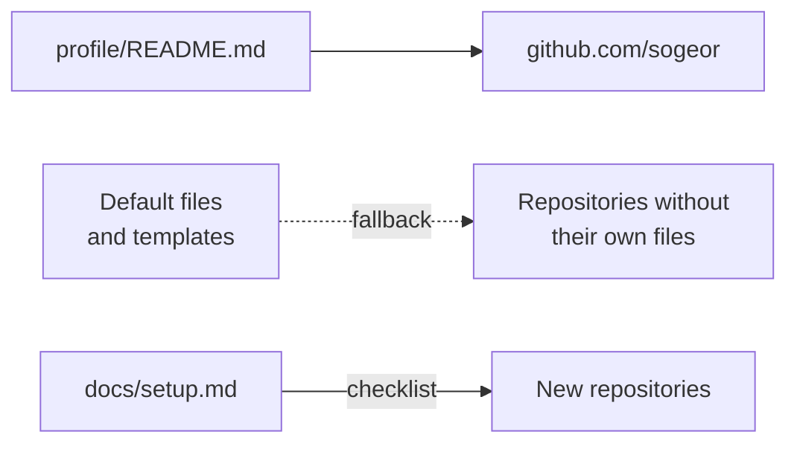

# .github

Organization profile and default community health files for [sogeor](https://github.com/sogeor).

[](https://github.com/sogeor/.github/actions/workflows/validate.yml)
[](https://github.com/sogeor/.github/actions/workflows/docs.yml)
[](https://scorecard.dev/viewer/?uri=github.com/sogeor/.github)
[](https://www.bestpractices.dev/projects/15351)
[](LICENSE)
[](https://github.com/sogeor/.github/releases/latest)

## Overview

- **Organization page:** what the platform is, the cluster constructor, the list of repositories
  with their status ([`profile/README.md`](profile/README.md)).
- **Default community files** for every repository without its own: security policy,
  contributing rules, code of conduct, governance, support.
- **Issue forms and pull request template** shared by all repositories.
- **Repository setup checklist:** the GitHub settings every sogeor repository uses.



## Quick start

```bash
git clone https://github.com/sogeor/.github.git sogeor-.github
cd sogeor-.github
pre-commit install
pre-commit run --all-files
```

Full walkthrough: [docs/getting-started.md](docs/getting-started.md).

## Documentation

| Page | Contents |
|---|---|
| [Overview](docs/index.md) | What this repository is and who it is for |
| [Getting started](docs/getting-started.md) | Tools, checks, documentation preview, first pull request |
| [Repository setup](docs/setup.md) | Checklist of GitHub settings for every repository |
| [Configuration](docs/configuration.md) | Inherited files, issue forms, workflows, secrets, linters |
| [Operations](docs/operations.md) | Add a repository to the profile, rotate tokens, update versions |
| [Architecture](docs/architecture.md) | How GitHub applies the defaults |
| [Security](docs/security.md) | Guarantees and threat model |
| [Troubleshooting](docs/troubleshooting.md) | Symptom → cause → solution |
| [Decisions](docs/adr/index.md) | Architecture decision records |

## Versions

| Tool | Version |
|---|---|
| sogeor/workflows (`docs`, `scorecard`) | v0.1.1 |
| actions/checkout | v7.0.1 |
| pre-commit-hooks | v6.0.0 |
| gitleaks | v8.30.1 |
| yamllint | v1.38.0 |
| markdownlint-cli2 | v0.23.3 |
| actionlint | v1.7.12 |
| zizmor | v1.30.1 |
| mkdocs-material | 9.7.7 |

## Contributing

See [CONTRIBUTING.md](CONTRIBUTING.md) and [SUPPORT.md](SUPPORT.md).

## Security

See [SECURITY.md](SECURITY.md) and [docs/security.md](docs/security.md).

## License

[Apache-2.0](LICENSE).
