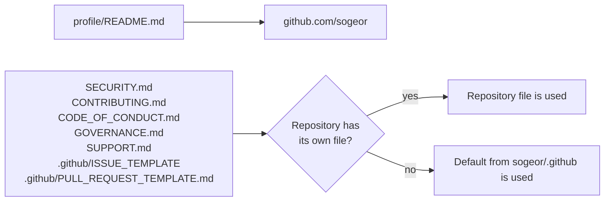

# Architecture

This repository has two roles: the public organization profile and the default
[community health files](https://docs.github.com/en/communities/setting-up-your-project-for-healthy-contributions/creating-a-default-community-health-file)
for all `sogeor` repositories.

## Interface

- **Fallback, not merge.** GitHub uses a default file only when the repository has no file of the
  same type in its root, `.github/` or `docs/`. A repository file replaces the default entirely.
- **Issue templates** are inherited as a whole: a repository with any `.github/ISSUE_TEMPLATE/`
  content does not get the defaults.
- **Not inherited:** `LICENSE`, `CODEOWNERS`, workflows, `renovate.json` and lint configuration.
  They apply to this repository only.
