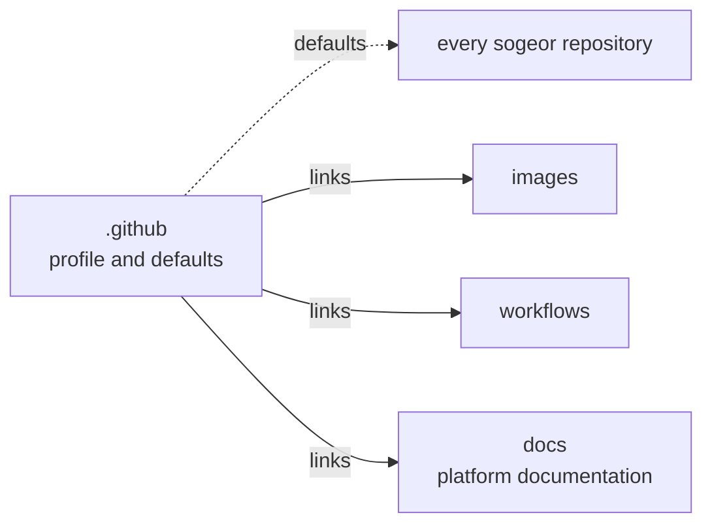

# sogeor .github

The organization profile and the default community health files for every repository in
[github.com/sogeor](https://github.com/sogeor).

## Who this is for

- **Visitors** who want to understand the platform in a minute: see the
  [organization page](https://github.com/sogeor).
- **Contributors** to any sogeor repository: the default rules for issues, pull requests,
  security reports and conduct live here.
- **Maintainers** creating a new repository: the [repository setup checklist](setup.md) applies to
  every repository in the organization.
- **Adopters** running their own organization on this model: fork this repository and follow
  [Getting started](getting-started.md).

## What you get

| Item | Effect |
|---|---|
| `profile/README.md` | Shown on the organization page |
| `SECURITY.md`, `CONTRIBUTING.md`, `CODE_OF_CONDUCT.md`, `GOVERNANCE.md`, `SUPPORT.md` | Used by every repository that has no file of its own |
| `.github/ISSUE_TEMPLATE/`, `.github/PULL_REQUEST_TEMPLATE.md` | Issue forms and pull request template for repositories without their own |
| [Repository setup](setup.md) | The checklist of GitHub settings for every sogeor repository |

## Place in the platform

This repository holds no infrastructure code. Platform-wide documentation, ADRs and runbooks are
published at [sogeor.github.io/docs](https://sogeor.github.io/docs/) from the
[`docs`](https://github.com/sogeor/docs) repository; reusable CI belongs in
[`workflows`](https://github.com/sogeor/workflows), and this repository's `docs` and `scorecard`
checks call it.

## Where to start

1. [Getting started](getting-started.md): clone, install tools, preview the documentation.
2. [Repository setup](setup.md): configure this repository or any new one.
3. [Operations](operations.md): add a repository to the profile, rotate the Scorecard token.
