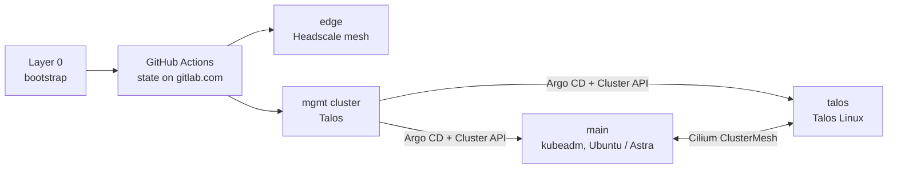

# sogeor

An open-source reference DevSecOps platform: build any Kubernetes cluster from a short
description, on a home Proxmox server or in the cloud, with security by default at every layer.
Aligned with international (CIS, NIST SSDF, SLSA, OWASP) and Russian (GOST R 56939-2024,
FSTEC orders, FSTEC BDU) frameworks.

## Architecture

- **Management cluster `mgmt`** (Talos): Argo CD, Cluster API with autoscaling, OpenBao,
  Keycloak, Harbor, GitLab, backups.
- **Workload clusters** are created from `mgmt` in the cloud, scale down to zero worker nodes and
  can be torn down and restored from backups in one operation.

## Cluster constructor

A cluster is a combination of independent axes; a new combination is a new description file,
not new code.

| Axis | Values |
|---|---|
| Distribution | Talos, kubeadm, k3s |
| Operating system (per node pool) | Ubuntu 24.04, Ubuntu 26.04, Astra Linux SE 1.8, Talos, Alpine (experimental) |
| Provider | Proxmox, Selectel, VK Cloud, Yandex Cloud, Timeweb, bring-your-own VDS |
| Topology | `single` (minimum cost) or `ha`, switched by configuration |
| Profiles | core, CI, data, security-plus, observability-plus, chaos, ru-track |

## Principles

- **Supply chain:** SLSA provenance, SBOM and VEX attestations, Cosign signatures verified at admission.
- **No static secrets in CI:** OIDC → OpenBao short-lived credentials.
- **Policy as code** on every layer: infrastructure plans, cluster descriptions, OS, admission, runtime, network.
- **Zero trust access:** short-lived SSH certificates, OIDC for the Kubernetes API, no public admin endpoints.
- **Self-healing:** nodes are recreated from descriptions, data is restored from backups automatically.
- **Documentation is part of the product:** every repository explains every option and every action.

## Repositories

| Repository | Purpose | Status |
|---|---|---|
| [`images`](https://github.com/sogeor/images) | VM images: Ubuntu for Proxmox, Talos Image Factory schematic | Ready  |
| [`.github`](https://github.com/sogeor/.github) | Organization profile and community defaults | Ready  |
| [`workflows`](https://github.com/sogeor/workflows) | Reusable GitHub Actions workflows and composite actions | Ready  |
| [`docs`](https://github.com/sogeor/docs) | Platform-wide documentation site, ADRs, runbooks | In progress  |
| `bootstrap` | Layer 0: Hyper-V, Proxmox, cloud accounts, secrets | Planned |
| [`modules`](https://github.com/sogeor/modules) | OpenTofu modules and the cluster constructor | In progress  |
| `management` | Outer contour: edge, mgmt cluster, DNS, Cloudflare | Planned |
| `platform` | GitOps for all clusters | Planned |
| `ansible` | Roles for non-Talos nodes | Planned |
| `ci-templates` | GitLab CI templates for the inner contour | Planned |
| `charts` | Shared Helm `service` chart | Planned |
| `store` | Online store running on the platform | Planned |
| `policies` | Policy and detection as code | Planned |
| `compliance` | Compliance matrix, evidence, tooling | Planned |

Documentation: [sogeor.github.io/docs](https://sogeor.github.io/docs/) — platform overview, cluster
constructor, ADRs and runbooks. Each repository also documents itself in its `docs/` directory.
