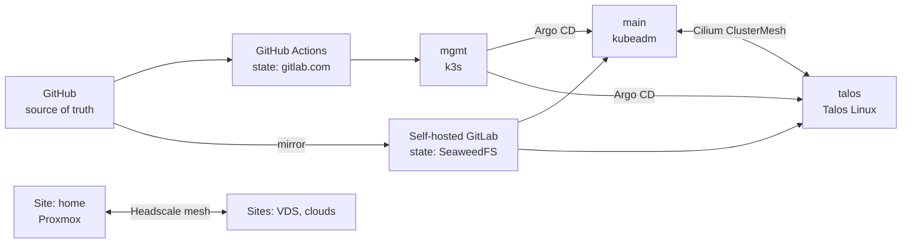

# sogeor

A provider-agnostic DevSecOps platform lab: hybrid home + VDS infrastructure, classic and
immutable Kubernetes clusters, and security by default at every layer. Aligned with both
international (CIS, NIST SSDF, SLSA, OWASP) and Russian (GOST R 56939-2024, FSTEC orders,
FSTEC BDU) frameworks.

## Architecture

| Cluster | OS | Distribution | Purpose |
|---|---|---|---|
| `mgmt` | Ubuntu 24.04 | k3s | Argo CD, OpenBao, Harbor, Keycloak, GitLab Runner, SeaweedFS |
| `main` | Ubuntu 24.04, Astra Linux | kubeadm + containerd | Workloads, CIS-hardened OS, Russian compliance track |
| `talos` | Talos Linux | built-in | Workloads, immutable approach, international track |

## Principles

- **Supply chain:** SLSA provenance, SBOM and VEX attestations, Cosign signatures verified at admission.
- **No static secrets in CI:** OIDC → OpenBao short-lived credentials.
- **Policy as code** on every layer: IaC plans, OS, admission, runtime, network.
- **Zero trust access:** short-lived SSH certificates, OIDC for kube-API, no public admin endpoints.
- **Provider-agnostic nodes:** Proxmox, clouds or any VDS behind one node contract.
- **Reliability:** tested backups, DR scenarios, chaos experiments, SLOs.

## Repositories

| Repository | Purpose | Status |
|---|---|---|
| [`packer-images`](https://github.com/sogeor/packer-images) | VM images (Ubuntu, Talos) | Active  |
| [`.github`](https://github.com/sogeor/.github) | Organization profile and community defaults | Active |
| `actions-workflows` | Reusable GitHub Actions workflows | Planned |
| `gitlab-ci-templates` | GitLab CI templates for the inner contour | Planned |
| `lab-bootstrap` | Layer 0: Hyper-V, Proxmox, ops VM | Planned |
| `infra` | OpenTofu modules and inner-contour infrastructure | Planned |
| `ansible` | Roles and playbooks for non-Talos nodes | Planned |
| `mgmt-infra` | OpenTofu for edge and the management cluster | Planned |
| `platform` | GitOps for all clusters | Planned |
| `helm-charts` | Shared `service` chart | Planned |
| `shoplite` | Demo microservice application | Planned |
| `policies` | Policy and detection as code | Planned |
| `compliance` | Compliance matrix, evidence, tooling | Planned |
| `docs` | Architecture, ADRs, runbooks | Planned |

Documentation: [`sogeor/docs`](https://github.com/sogeor/docs).
